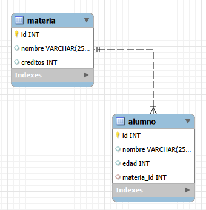
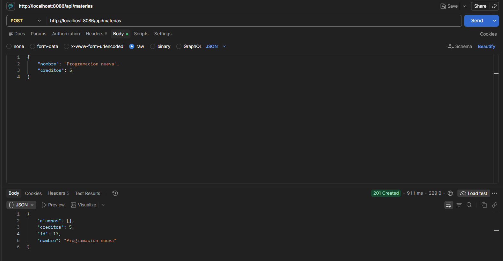
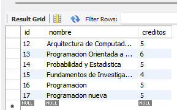
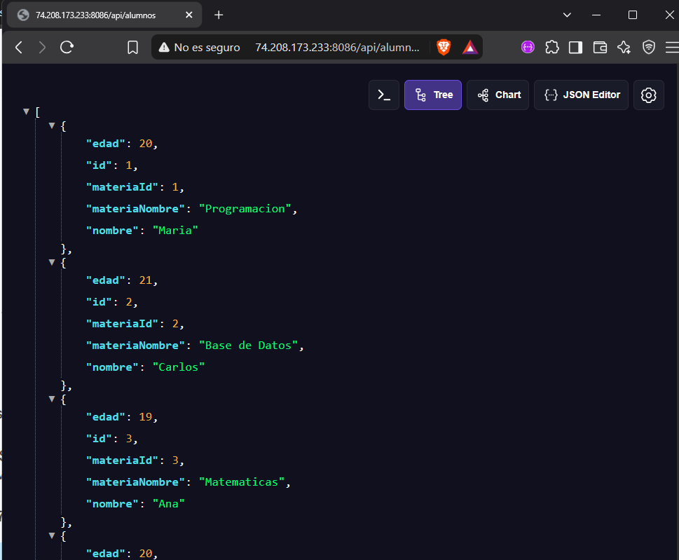
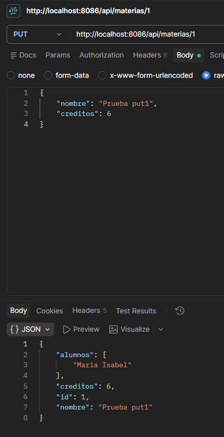
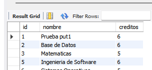
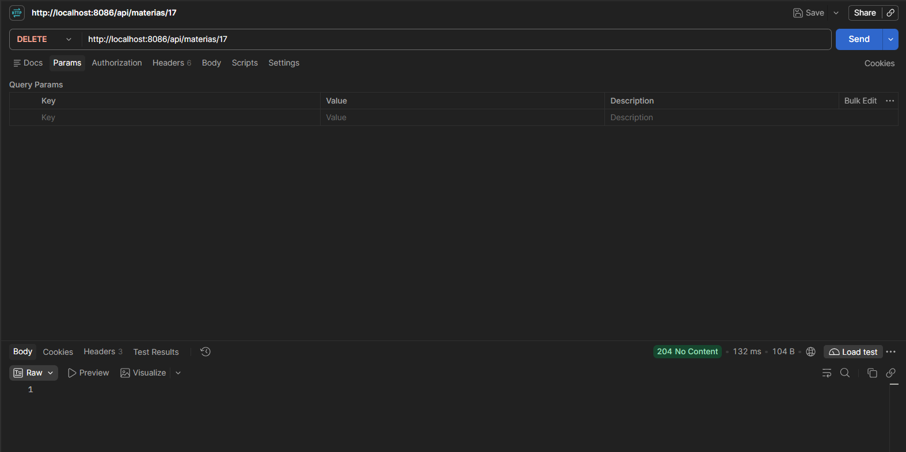
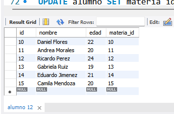

# MIPCact3_t4

## Descripción

Este proyecto consiste en el desarrollo de una aplicación web utilizando Spring Boot, conectada a una base de datos MySQL. Su objetivo es implementar un CRUD completo (Crear, Leer, Actualizar y Eliminar), utilizando Spring Data JPA para gestionar la persistencia de los datos.

La aplicación implementa dos entidades relacionadas entre sí mediante anotaciones JPA, permitiendo almacenar y consultar información relacionada desde la base de datos.

El desarrollo se realizó dentro de un mismo proyecto Spring Boot, utilizando las capas de Entity, Repository, Service y Controller para organizar el código.

## Tecnologías utilizadas

- Java
- Spring Boot
- Spring Data JPA
- MySQL
- Maven
- Thymeleaf
- HTML y CSS

## Estructura del proyecto

El proyecto utiliza una arquitectura por capas:

- **Entity:** define las entidades y sus relaciones.
- **Repository:** permite realizar operaciones sobre la base de datos mediante JpaRepository.
- **Service:** contiene la lógica de negocio.
- **Controller:** recibe las solicitudes y gestiona las operaciones del CRUD.
- **Templates:** contiene las vistas HTML de la aplicación.

## Entidades y relación

Se implementaron dos entidades relacionadas mediante JPA:

- **Alumno:** Representa a los estudiantes, almacenando información como su nombre, edad y la materia a la que están inscritos.
- **Materia:** Representa las materias disponibles, almacenando su nombre , número de créditos y un id.

La relación implementada es de muchos a uno (`@ManyToOne`), ya que varios alumnos pueden estar inscritos en una misma materia.

### Evidencia de las entidades

## Operaciones CRUD

Se implementaron las cuatro operaciones principales para administrar los registros de la entidad principal.

### 1. Crear (Create)

Permite registrar nuevos datos en la aplicación, almacenándolos en la base de datos y asociándolos con la entidad relacionada.

### 2. Consultar (Read)

Permite visualizar los registros almacenados en la base de datos. También se muestra la información de la entidad relacionada, en lugar de mostrar únicamente su identificador.

### 3. Actualizar (Update)

Permite modificar la información de un registro existente y guardar los cambios en la base de datos.

### 4. Eliminar (Delete)

Permite eliminar un registro de la base de datos mediante la operación correspondiente.

## Despliegue en VPS

La aplicación también fue desplegada en un servidor VPS, utilizando una base de datos MySQL alojada en el mismo servidor.

Se generó el archivo JAR del proyecto y se ejecutó en un puerto independiente para evitar afectar las aplicaciones desarrolladas en actividades anteriores.

**URL de la aplicación:** [Agregar enlace de acceso al proyecto].

**Puerto utilizado:** [Agregar puerto].

**Base de datos:** MySQL.

## Autor

María Isabel Pérez Cruz